<div align="center">


<br/>

<a href="https://gunara.web.id"></a>

<br/>

<!-- badge utama -->
[](https://nextjs.org)
[](https://react.dev)
[](https://www.typescriptlang.org)
[](https://tailwindcss.com)
[](https://bun.sh)

<!-- badge kualitas -->
[](#-sistem-warna-tersertifikasi)
[](LICENSE)
[](https://gunara.web.id)
[](VERSIONING.md)
[](ROADMAP.md)
[](https://github.com/gunaracorp/gunarawebid)

<br/>

**gunara.web.id** adalah pusat kendali ekosistem digital **Gugun Gunara** — arsitek di balik
**Gunara OS** (165 dokumen arsitektur kelembagaan), metodologi **UMEA / Hukum Minimum Usaha**,
**G-DOS**, dan **UWA-7**. Satu otak, banyak organ.

[🚀 Kunjungi Situs Langsung](https://gunara.web.id) ·
[📖 Brand Guideline PDF](docs/brand/gunara-brand-guideline.pdf) ·
[🧰 Tools Kontras](tools/contrast.py) ·
[🐛 Laporkan Bug](https://github.com/gunaracorp/gunarawebid/issues)

<br/>

</div>

<!-- ══════════════════════ GALERI ══════════════════════ -->

## Galeri Antarmuka

<div align="center">

| Dark Mode — Hero | Light Mode — Hero |
| :---: | :---: |
| 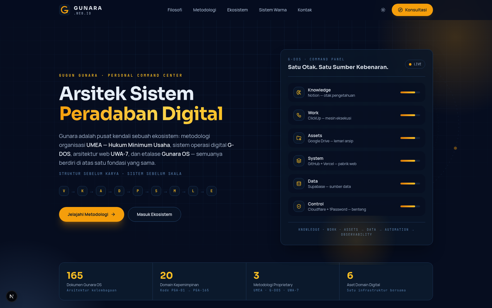 | 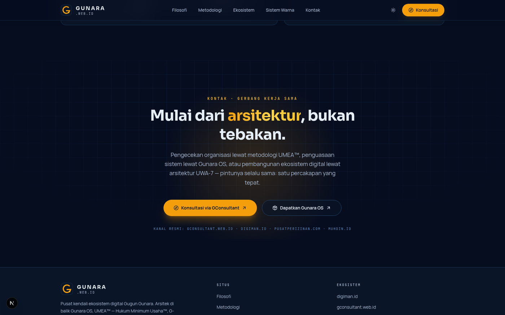 |

| Metodologi — Tabs Interaktif | Ekosistem — 6 Domain |
| :---: | :---: |
| 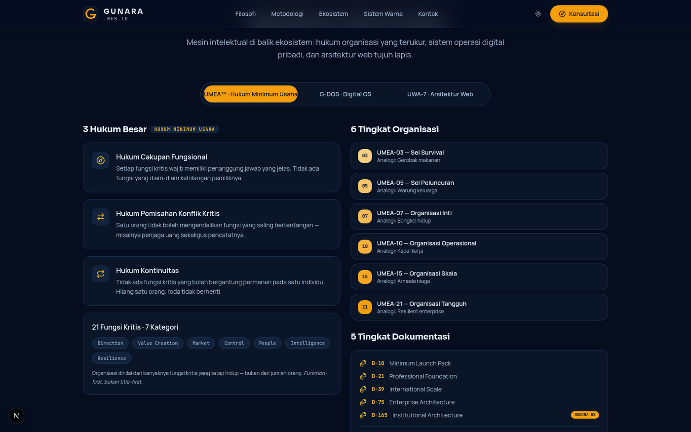 | 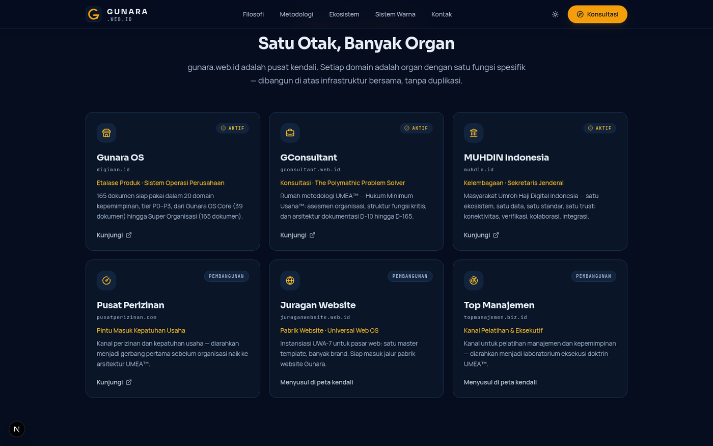 |

| Brand System — Palet & Kontras | CTA — Kontak |
| :---: | :---: |
| 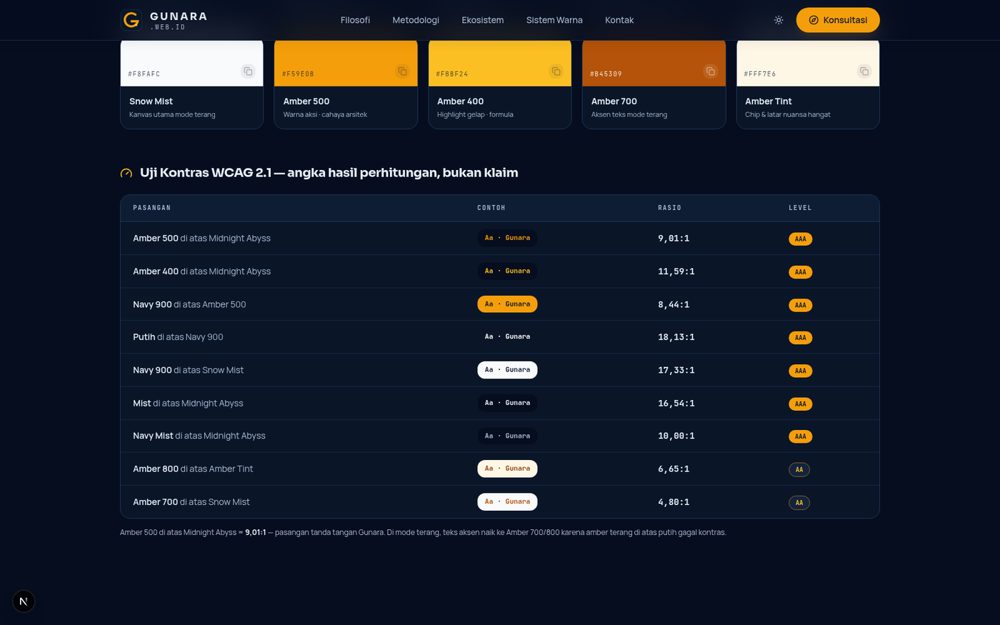 | 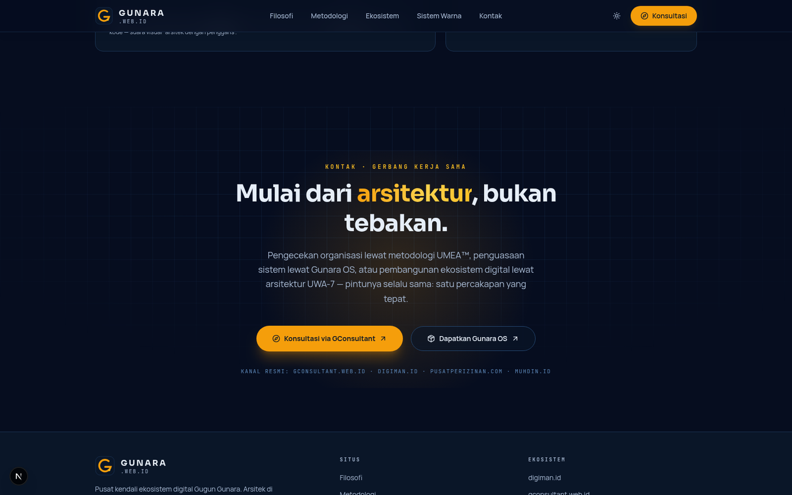 |

</div>

<!-- ══════════════════════ FITUR ══════════════════════ -->

## Fitur Utama

- **Personal Command Center** — satu halaman memetakan seluruh ekosistem digital: metodologi, ekosistem domain, dan sistem identitas.
- **DNA Formula Interaktif** — rumus `V → K → A → D → P → S → M → L → E` di hero dengan animasi reveal bertahap.
- **Command Palette G-DOS** — panel perintah bergaya terminal di hero, menghadirkan nuansa "operating system".
- **Dual Theme** — mode gelap (default) dan terang dengan transisi halus; token warna terpusat di CSS variables.
- **Sistem Warna Tersertifikasi** — tabel kontras WCAG riil, dihitung dengan script Python, bukan klaim kosong.
- **Klik-untuk-Salin Palet** — setiap swatch warna menyalin nilai hex ke clipboard.
- **Arsitektur Konten UWA-7** — 7 lapisan informasi: Alam Fisik, Akal, Ilmu, Penglihatan, Rahmah, Otoritas, Waktu.
- **SEO & Structured Data** — metadata OpenGraph, Twitter Card, dan JSON-LD `Person` lengkap dengan `knowsAbout` dan `worksFor`.
- **Aksesibilitas** — semantic HTML, skip-link, `aria-labelledby`, dukungan `prefers-reduced-motion`, dan status bar `dt/dd` yang benar.
- **Performa** — Next.js 16 Turbopack, React 19, font self-hosted via `next/font` (Sora, Manrope, JetBrains Mono).

<!-- ══════════════════════ FILOSOFI ══════════════════════ -->

## Filosofi & DNA Formula

Setiap keputusan desain situs ini lahir dari satu rumus belajar seumur hidup:

```text
   V ──→ K ──→ A ──→ D ──→ P ──→ S ──→ M ──→ L ──→ E
   │     │     │     │     │     │     │     │     └─ Eksistensi
   │     │     │     │     │     │     │     └─────── Lepas
   │     │     │     │     │     │     └───────────── Mandekati
   │     │     │     │     │     └─────────────────── Sabar
   │     │     │     │     └───────────────────────── Perduli
   │     │     │     └─────────────────────────────── Dikuasai
   │     │     └───────────────────────────────────── Amanah
   │     └─────────────────────────────────────────── Kuasai
   └───────────────────────────────────────────────── Verifikasi
```

Empat prinsip yang mengikat seluruh sistem:

| Prinsip | Makna |
| :--- | :--- |
| **Struktur sebelum karya** | Arsitektur didokumentasikan (UWA-7) sebelum satu baris kode ditulis. |
| **Sistem sebelum skala** | Skala tidak dikejar — sistem yang membuat skala tak terhindarkan. |
| **Function-first** | Setiap domain adalah organ dengan satu fungsi spesifik, tanpa duplikasi. |
| **Satu otak, banyak organ** | gunara.web.id adalah pusat kendali; semua domain terhubung ke satu sumber kebenaran. |

<!-- ══════════════════════ METODOLOGI ══════════════════════ -->

## Tiga Doktrin, Satu Fondasi

### UMEA — Universal Minimum Enterprise Architecture

Tangga organisasi dari unit terkecil yang tetap bisa bertahan hidup:

| Tier | Nama | Analogi |
| :--- | :--- | :--- |
| UMEA-03 | Sel Survival | Gerobak makanan |
| UMEA-05 | Sel Peluncuran | Warung keluarga |
| UMEA-07 | Organisasi Inti | Bengkel hidup |
| UMEA-10 | Organisasi Operasional | Kapal kerja |
| UMEA-15 | Organisasi Skala | Armada niaga |
| UMEA-21 | Organisasi Tangguh | Resilient enterprise |

### G-DOS — Gugun Digital Operating System

Paket peluncuran yang dipilih sesuai skala target:

| Pack | Nama |
| :--- | :--- |
| D-10 | Minimum Launch Pack |
| D-21 | Professional Foundation |
| D-39 | International Scale |
| D-75 | Enterprise Architecture |
| D-165 | Institutional Architecture |

### UWA-7 — Unified Web Architecture

Tujuh lapisan yang memandu setiap proyek web di ekosistem:

`01 Alam Fisik` · `02 Akal` · `03 Ilmu` · `04 Penglihatan` · `05 Rahmah` · `06 Otoritas` · `07 Waktu`

<!-- ══════════════════════ EKOSISTEM ══════════════════════ -->

## Ekosistem Digital

| Domain | Status | Fungsi |
| :--- | :---: | :--- |
| [digiman.id](https://www.digiman.id) |  | 165 dokumen siap pakai dalam 20 domain kepemimpinan, tier P0–P3 — dari Gunara OS Core (39 dokumen) hingga Super Organisasi (165 dokumen). |
| [gconsultant.web.id](https://www.gconsultant.web.id) |  | Konsultasi & pendampingan strategi. |
| [muhdin.id](https://muhdin.id) |  | MUHDIN Indonesia — organisasi masa depan. |
| [pusatperizinan.com](https://www.pusatperizinan.com) |  | Pusat layanan perizinan usaha. |
| [juraganwebsite.web.id](https://juraganwebsite.web.id) |  | Gunara OS — mesin produk web. |
| [topmanajemen.biz.id](https://topmanajemen.biz.id) |  | Publikasi manajemen puncak. |

> Prinsip arsitektur ekosistem: **setiap domain satu fungsi** — dibangun di atas infrastruktur bersama, tanpa duplikasi.

<!-- ══════════════════════ BRAND ══════════════════════ -->

## Sistem Warna Tersertifikasi

Kontras dihitung dengan [tools/contrast.py](tools/contrast.py) sesuai algoritma WCAG 2.1 — bukan klaim manual.

<div align="center">

| Midnight Abyss | Midnight Navy | Navy Surface |
| :---: | :---: | :---: |
| 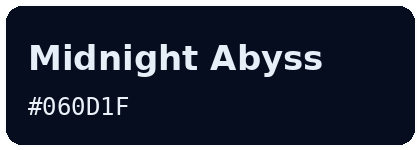 | 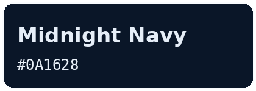 | 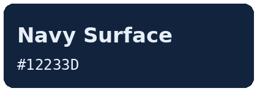 |
| **Snow** | **Amber 500** | **Amber 400** |
| 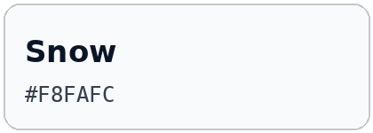 | 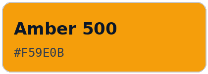 | 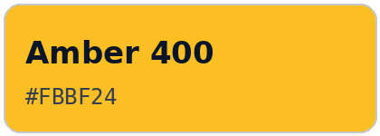 |

</div>

Pasangan warna paling kritis, hasil pengukuran:

| Kombinasi | Rasio | Level |
| :--- | :---: | :---: |
| **Amber 500** `#F59E0B` di atas **Midnight Abyss** `#060D1F` | **9.01 : 1** | `AAA` |
| Amber 400 `#FBBF24` di atas Midnight Abyss `#060D1F` | 11.59 : 1 | `AAA` |
| Midnight Navy 900 `#0A1628` di atas Amber 500 `#F59E0B` | 8.44 : 1 | `AAA` |
| Mist Foreground `#E6EEF8` di atas Midnight Abyss `#060D1F` | 16.54 : 1 | `AAA` |
| Midnight Navy 900 `#0A1628` di atas Snow Mist `#F8FAFC` | 17.33 : 1 | `AAA` |
| Navy 400 `#5C87B8` di atas Midnight Abyss `#060D1F` | 5.17 : 1 | `AA` |

Ulangi pengukuran sendiri kapan saja:

```bash
bun run contrast        # python3 tools/contrast.py
```

### Tipografi

| Peran | Font | Catatan |
| :--- | :--- | :--- |
| Heading | **Sora** | Geometris, tegas — identitas "arsitek". |
| Body | **Manrope** | Nyaman dibaca panjang. |
| Token / Kode | **JetBrains Mono** | Formula, angka kontras, command palette. |

Semua font dimuat via `next/font` — self-hosted otomatis, tanpa layout shift.

<!-- ══════════════════════ TEKNOLOGI ══════════════════════ -->

## Teknologi

| Lapisan | Teknologi |
| :--- | :--- |
| Framework | Next.js 16 (App Router, Turbopack, standalone output) |
| UI | React 19 · TypeScript 5 · Tailwind CSS 4 · shadcn/ui · Radix UI |
| Animasi | Framer Motion 12 · CSS custom animations |
| Font | Sora · Manrope · JetBrains Mono (`next/font`) |
| Runtime | Bun 1.3+ (dev, build, start) |
| Kualitas | ESLint 9 · WCAG 2.1 contrast checker |

## Struktur Proyek

```text
gunarawebid/
├── src/
│   ├── app/
│   │   ├── layout.tsx          # metadata SEO + JSON-LD Person + ThemeProvider
│   │   ├── page.tsx            # komposisi 7 section
│   │   ├── globals.css         # design tokens navy-amber + animasi
│   │   └── api/route.ts        # health check endpoint
│   ├── components/
│   │   ├── gunara/             # hero, philosophy, methodology, ecosystem,
│   │   │                       # brand-system, contact-cta, header, footer
│   │   └── ui/                 # komponen shadcn/ui
│   ├── hooks/                  # use-toast, use-mobile
│   └── lib/                    # utils, db client
├── docs/
│   ├── assets/                 # banner animasi, screenshot, swatch
│   └── brand/                  # gunara-brand-guideline.pdf (9 halaman)
├── tools/
│   ├── contrast.py             # pengukur kontras WCAG 2.1
│   ├── contrast-results.json   # 15 pasangan warna terukur
│   └── stamp_pages.py          # penomoran halaman PDF brand guideline
├── .github/workflows/          # CI build + snake animation
├── public/                     # logo.svg, gunara-mark.svg, robots.txt
├── prisma/                     # schema database (opsional)
└── package.json
```

<!-- ══════════════════════ MULAI ══════════════════════ -->

## Mulai Cepat

**Prasyarat:** Node.js >= 20 · Bun >= 1.3

```bash
# 1. Clone
git clone https://github.com/gunaracorp/gunarawebid.git
cd gunarawebid

# 2. Install dependensi
bun install

# 3. Mode pengembangan (http://localhost:3000)
bun run dev

# 4. Build produksi + jalankan
bun run build
bun run start
```

Atau dengan npm/pnpm — semua skrip kompatibel:

```bash
npm install && npm run dev
```

### Skrip

| Perintah | Fungsi |
| :--- | :--- |
| `bun run dev` | Development server di port 3000 |
| `bun run build` | Build produksi standalone + salin static/public |
| `bun run start` | Jalankan hasil build produksi |
| `bun run lint` | ESLint seluruh proyek |
| `bun run contrast` | Ukur ulang kontras WCAG (Python) |
| `bun run db:generate` | Generate Prisma client |

### Deployment

Rekomendasi mengikuti lapisan **Otoritas** pada UWA-7:

1. Push ke branch `main` — CI membangun dan memverifikasi.
2. Import repo ke [Vercel](https://vercel.com) — zero-config untuk Next.js standalone.
3. DNS diarahkan ke Vercel melalui **Cloudflare** (internet edge G-DOS).
4. Domain produksi: `gunara.web.id`.

<!-- ══════════════════════ ROADMAP ══════════════════════ -->

## Roadmap 99 Hari — v1.0.0.0 → v2.0.0.0

Peta jalan upgrade 99 hari (21 Nov 2026 – 27 Feb 2027) dalam 10 fase mengikuti lapisan UWA-7.
Satu hari = satu roadmap = satu commit = satu entri worklog = satu kenaikan versi.

| Dokumen Tata Kelola | Fungsi |
| :--- | :--- |
| [ROADMAP.md](ROADMAP.md) | Checklist 99 hari — 10 fase, 46 perspektif dewan pakar, target versi per hari |
| [WORKLOG.md](WORKLOG.md) | Log eksekusi harian: hasil, bukti, versi |
| [VERSIONING.md](VERSIONING.md) | Skema versi `MAJOR.MINOR.PATCH.BUILD` Gunara OS |
| [Roadmap PDF](docs/roadmap/gunara-os-roadmap-99-hari.pdf) | Dokumen desain lengkap 99 hari (35 halaman) |
| [Brand Guideline PDF](docs/brand/gunara-brand-guideline.pdf) | Identitas navy-amber v1.0 (9 halaman) |

**Status saat ini:** `v1.0.0.1` · Fase 1 — Fondasi & Tata Kelola (Day 1–9) · Progres 1/99 hari.

**Protokol lanjutan:** buka sesi baru dengan perintah `LANJUTKAN GUNARA-OS DAY-XX` —
seluruh hari tersisa dieksekusi berurutan, lengkap dengan update README/worklog/versi.

<details>
<summary><b>Ringkasan 10 Fase (klik untuk buka)</b></summary>

| Fase | Hari | Fokus | Target |
|---|---|---|---|
| F1 | 1–9 | Fondasi & Tata Kelola | v1.1.0.9 |
| F2 | 10–18 | Otoritas Domain & Produksi (Vercel + Cloudflare) | v1.2.0.18 |
| F3 | 19–30 | Arsitektur Konten (metodologi, blog, layanan) | v1.3.0.30 |
| F4 | 31–40 | Sistem Identitas Visual 2.0 | v1.4.0.40 |
| F5 | 41–52 | Pengalaman Interaktif (kalkulator UMEA, explorer UWA-7) | v1.5.0.52 |
| F6 | 53–62 | Mesin Konversi | v1.6.0.62 |
| F7 | 63–72 | Intelijen & Otomasi AI (G-DOS Copilot) | v1.7.0.72 |
| F8 | 73–84 | Ekosistem & Produk (portal Gunara OS, member area, API) | v1.8.0.84 |
| F9 | 85–92 | Sertifikasi & Tata Kelola Mutu (WCAG 2.2, OWASP) | v1.9.0.92 |
| F10 | 93–99 | Peluncuran Peradaban v2.0.0.0 | v2.0.0.99 |

</details>

<details>
<summary><b>Capaian generasi 1 (klik untuk buka)</b></summary>

- [x] Sistem identitas navy-amber + token terpusat
- [x] 7 section lengkap dengan animasi reveal
- [x] Sertifikasi kontras WCAG (script terukur)
- [x] Brand guideline PDF 9 halaman
- [ ] Foto profil resmi menggantikan placeholder (terjadwal ulang di roadmap 99 hari)
- [ ] Halaman Gunara OS di juraganwebsite.web.id → Day 73
- [ ] Multi-bahasa (id / en) via `next-intl` → Day 29
- [ ] Form kontak terhubung backend → Day 56

</details>

<!-- ══════════════════════ STATS ══════════════════════ -->

## Statistik Repository

<div align="center">


&nbsp;


<br/>


&nbsp;


<br/>

### Animasi Kontribusi

<picture>
  <source media="(prefers-color-scheme: dark)" srcset="https://raw.githubusercontent.com/gunaracorp/gunarawebid/output/github-contribution-grid-snake-dark.svg"/>
  
</picture>

_Dihasilkan otomatis oleh [GitHub Actions](.github/workflows/snake.yml) setiap 12 jam._

</div>

<!-- ══════════════════════ KONTRIBUSI ══════════════════════ -->

## Kontribusi

Improvement dipersilakan mengikuti rambu brand:

1. Fork repo ini.
2. Buat branch fitur: `git checkout -b fitur/nama-fitur`.
3. Commit mengikuti [Conventional Commits](https://www.conventionalcommits.org/id/v1.0.0/): `feat: ...`, `fix: ...`, `docs: ...`.
4. Pastikan `bun run lint` dan `bun run build` lulus.
5. Buka Pull Request ke `main`.

Palet dan tipografi **tidak boleh diubah tanpa sinkronisasi** dengan [docs/brand/gunara-brand-guideline.pdf](docs/brand/gunara-brand-guideline.pdf) — konsistensi adalah bagian dari sistem.

## Lisensi

- **Kode** dirilis di bawah [MIT License](LICENSE) — bebas dipelajari, digunakan, dan dimodifikasi.
- **Identitas merek** (nama Gunara, logo, palet warna, brand guideline, metodologi UMEA / G-DOS / UWA-7) adalah hak milik **Gugun Gunara** dan tidak termasuk dalam lisensi kode.

---

<div align="center">

**Dibangun mengikuti UWA-7 · Dikelola lewat G-DOS · Diarsiteki dengan UMEA**

[gunara.web.id](https://gunara.web.id) · [digiman.id](https://www.digiman.id) · [gconsultant.web.id](https://www.gconsultant.web.id) · [muhdin.id](https://muhdin.id)

<br/>


<br/><br/>

© 2026 Gugun Gunara — Satu otak, banyak organ.

</div>
